# Scheduling agent

The repository already has the important domain tools: `generateSchedule`,
`validateSchedule`, approved dated requests, locked assignments, undo, and
manager-controlled publishing. This implementation connects those tools through
a persistent LangGraph loop and adds a proposal review panel to the scheduler.

```mermaid
flowchart LR
    A[Snapshot draft] --> B[Inspect rules, requests, locks]
    B --> C[Plan strategy order]
    C --> D[Generate candidate]
    D --> E[Independent validation and scoring]
    E -->|Another strategy, maximum four| D
    E --> F[Save best valid proposal]
    F --> G[Pause for manager review]
    G --> H[Recheck draft and live requests]
    H --> I[Apply to draft with Undo]
    I --> J[Existing Publish week action]
```



## Run locally

Requires Node 22 and `npm ci`. The agent is a separate process because this
Next.js app exports static files; GitHub Pages cannot run a server-side loop.

1. Run the existing local Worker with a local manager code, D1 migrations, and
   synthetic data using [LOCAL_DATA.md](../worker/LOCAL_DATA.md). The requests
   endpoint must work, even when its saved record is `null`. A missing D1 binding
   blocks proposals rather than treating unconfirmed requests as empty.
2. Copy `agent/.env.example` to `.env.agent` at the repository root. Set
   `AGENT_MANAGER_TOKEN` to the local Worker's manager code, at least 16 characters.
   The default API target is `http://127.0.0.1:8787`; there is no production fallback.
3. Set these public frontend values in `.env.local`:

   ```dotenv
   NEXT_PUBLIC_SCHEDULE_API=http://127.0.0.1:8787
   NEXT_PUBLIC_AGENT_API=http://127.0.0.1:8790
   ```

4. Start `npm run agent:dev` and `npm run dev` in separate terminals. Open the
   scheduler at `http://localhost:3000/scheduler-demo/CR3-diningroom/`, enter the
   local manager code, and choose **Open assistant → Make proposal**.
5. Review the coverage, hours, changes, and work log. **Use proposal** updates the
   draft and creates an Undo snapshot. **Publish week** remains the existing
   separate action.

The panel is hidden when `NEXT_PUBLIC_AGENT_API` is empty. That URL is public;
manager codes and model keys belong only in private server configuration.

## What is implemented

- A typed LangGraph state machine, with real SQLite checkpoints after graph
  steps and an `interrupt()` at manager review. Closing the tab does not stop the
  backend. On restart, the service resumes registered unfinished runs from their
  last saved state. Review decisions survive a restart too.
- Four existing strategies: balanced, fewer doubles, similar to the current
  draft, and fair hours. Each result is independently validated. The selected
  goal ranks valid candidates using doubles, hours spread, and changed spots.
- At most four candidate attempts, each using the existing solver's six weight
  profiles with a 15,000-node limit per profile. No claim of mathematical
  optimality or proven infeasibility follows from exhausting that budget.
- Approved leave/availability is applied as dated constraints. Invalid locked
  assignments and approved in-week requests whose employee cannot be found stop
  the run. The agent cannot weaken qualifications, change staffing requirements,
  edit the crew, approve requests, or publish a schedule.
- An optional Anthropic structured planner can order the same four strategies.
  Set both `ANTHROPIC_API_KEY` and `AGENT_ANTHROPIC_MODEL` on the agent service.
  It receives the selected goal and optional API-submitted guidance, with a
  400-output-token cap, 15-second deadline, and no model retries. Provider failure
  falls back to the built-in strategy order. The UI currently exposes goal
  selection; this is not a general conversational scheduling assistant.
- The planner receives no roster or request records automatically. Instructions
  submitted through the API are user text and could themselves contain private
  information. Raw graph tracing is not enabled by this implementation; enabling
  external tracing requires reviewing what graph state it captures.
- Server-side bearer authentication, an exact allowed origin, bounded request
  sizes, two active runs per process, and 12 new runs per hour for the shared
  manager credential. UUID operation IDs make create/decision retries idempotent.
- Acceptance checks the exact input snapshot and independently rereads approved
  requests from the Worker. The browser checks again after the response so an
  edit made while waiting is preserved. Existing publication validation and
  revision checks still apply when the manager later publishes.
- Run IDs are remembered per station/week on the device. Credentials are never
  saved in checkpoints, browser storage, URLs, or application logs. Checkpoints
  do contain private scheduling drafts. Local files use restrictive permissions,
  and `.agent-data/` and `.env.agent` are ignored by git.
- Runs and checkpoints expire after seven days, cleaned at startup, new creates,
  and hourly while the service runs. This is transient proposal history, not a
  replacement for publication history or a permanent audit archive.

## Architecture choice

LangChain is compatible with this TypeScript application. LangGraph is the
useful orchestration layer here: its
[persistent checkpoints](https://docs.langchain.com/oss/javascript/langgraph/persistence)
and [interrupt/resume support](https://docs.langchain.com/oss/javascript/langgraph/interrupts)
fit a schedule that waits for manager review. LangChain's
[Anthropic integration](https://docs.langchain.com/oss/javascript/integrations/chat/anthropic)
is an optional planner adapter. Domain correctness stays in the existing solver
and validator, independently of model output.

The graph owns the investigation; it has no publication tool. Its loop compares
observed candidates and keeps the best valid result. This provides useful
bounded autonomy without giving the model control of business rules.

Runtime packages adopted: `@langchain/langgraph` 1.7.1,
`@langchain/langgraph-checkpoint-sqlite` 1.1.0, `@langchain/anthropic` 1.6.0,
and `zod` 4.6.7, all MIT. `jiti` 2.7.0 is an MIT development/runtime loader.
SQLite's native dependency is supplied by the official checkpointer. Dependency
licenses and notices remain with their installed packages; the lockfile records
the full dependency tree.

## API

All requests require `Authorization: Bearer <manager code>`. Browser requests
must come from `AGENT_ALLOWED_ORIGIN`.

| Method | Path | Purpose |
| --- | --- | --- |
| GET | `/api/agent/health` | Authenticated readiness and planner mode |
| POST | `/api/agent/runs` | `{ id: UUID, context, goal, instructions?: string }`; returns 202 |
| GET | `/api/agent/runs/:id` | Poll progress and retrieve a saved proposal |
| POST | `/api/agent/runs/:id/decision` | `{ accept: false }` to dismiss, or `{ accept: true, context }` to accept the exact original draft snapshot |

`context` includes the station, Sunday week start, crew, template, current
assignments, and approved-request snapshot/revision. It represents the manager's
draft, which can differ from the saved roster. The service verifies the request
record against the existing Worker and returns only a run view, metrics, trace,
diagnostics, and proposal assignments. It does not return the full input crew.

## Verification

```sh
npm run agent:test
npm run scheduler:test
npm run scheduler:requests:test
npx tsc --noEmit
npm run build
```

Agent tests use synthetic employees and in-memory/temporary SQLite files. They
cover leave, locks, invalid solver output, impossible coverage, planner outages,
candidate ranking, restart/resume, authentication, request/draft freshness,
idempotency, malformed bodies, and quotas. They never call production services
or a paid model. Browser integration checks use synthetic HTTP fixtures too;
see `scripts/test-scheduling-agent.py`.
Recorded local results and execution limits are in [VERIFICATION.md](VERIFICATION.md).

## Production activation and next work

This is a locally verified first scheduling-agent implementation. No service,
Worker, database migration, or frontend has been deployed by this task.

1. Choose a Node host with a persistent private disk. Run **one process per
   SQLite database**, using Node 22 and the full `npm ci` install (the TypeScript
   loader currently lives in devDependencies). Inject server configuration and
   use `npm run agent:start`. An ephemeral serverless filesystem will not retain
   checkpoints; multiple instances require a shared checkpointer and distributed
   run coordination before scaling.
2. Use HTTPS, set the exact frontend origin and existing Worker API URL, and
   configure the same strong manager code on the Worker and agent. Rotation must
   update both. The inherited shared-code model does not identify individual
   managers; per-person access and scoped ownership are the next authentication
   improvement. Protect and back up the checkpoint volume.
3. Set the `NEXT_PUBLIC_AGENT_API` GitHub repository variable to the hosted
   service's HTTPS URL and rebuild the frontend. The deployment workflow now
   passes this optional value and runs agent/scheduler tests. Leaving it unset
   preserves the current frontend behavior.
4. Run a staging pilot with representative crews, locks, requests, and difficult
   weeks. Measure coverage, validation failures, changed spots, doubles, response
   time, and manager acceptance before enabling scheduled autonomous runs.
5. Resolve outstanding policies in `AMBIGUITIES.md`. Existing `newHire` role
   behavior and other solver policies are inherited; the model must not invent
   missing business decisions.
6. The next product increment should be structured conversational requests that
   produce reviewable availability/lock changes, followed by minimal-change
   repair after an absence. Add event/cron triggers only after manager ownership,
   notification destinations, and duplicate-run rules are defined. External
   notifications and automatic publishing are not part of this implementation.
