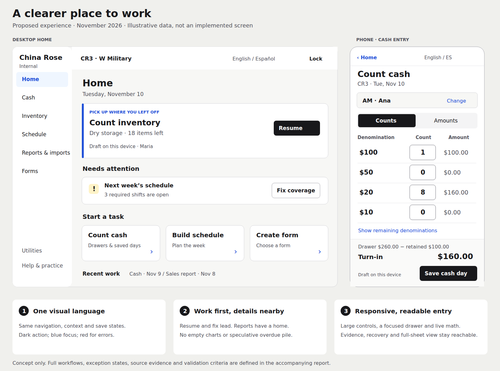

# Make the work obvious: China Rose internal tools overhaul

Research and source audit: **November 10, 2026**. Deliverable: a design and feature proposal, not an implemented redesign.

**Approved design and execution:** the owner selected **Night shift + Layered paper + Patina teal**, using white, black and the existing public-site red. The [design bank and guidelines](../design/internal-language/README.md) supersede this report's proposed blue/green/amber visual palette. Use the [step-by-step implementation guide](../internal-tools-overhaul/implementation-guide.md) to deliver the workflow changes with checks and review at each step. The earlier concept below is retained as the first iteration.

## Recommendation

Rebuild the experience around **doing one recognizable job, seeing progress, and knowing it is safely finished**. Keep the restaurant-specific calculations and scheduling engine. Replace the collection of loosely related screens with one calm, responsive application.

Your instinct about bigger buttons, contrast and readable text is right. The larger opportunity is structural: fewer competing decisions, less repeated setup, less explanation of implementation details, and a much clearer relationship between an action and its result. A large button on a confusing page is still confusing.

The target should feel like a good interactive tutorial: an obvious first move, feedback after that move, and a clear next move. Routine users should be able to work quickly without repeatedly taking a tutorial. Adult staff deserve simple, respectful language; we do not need a childish visual theme.

The proposed overhaul has six parts:

1. **One application shell:** consistent navigation, store context, language, help and lock controls across every manager tool.
2. **Home for work; Reports for analysis:** lead with resume/start actions and specific exceptions, and give cash charts their own destination.
3. **Three reusable workspace patterns:** fast entry for counts, staged review for imports/forms, and a planning board for schedules.
4. **A real content reduction:** remove repeated descriptions, derive information already known, and move provenance, recovery tools and configuration to clearly named secondary views.
5. **Visible, dependable outcomes:** distinguish device drafts, shared saves, downloads and published schedules. Add record-specific links and explicit progress semantics.
6. **Teaching through interaction:** contextual examples, optional practice, reversible moves and concise completion feedback.

See the [visual concept](internal-tools-ux-assets/overhaul-concept.svg), [current-screen evidence](internal-tools-ux-assets/README.md), [priority plan](#12-delivery-plan) and [evaluation protocol](#13-how-we-will-know-it-works).

## 1. What this report actually establishes

### Current main, rather than an old planning snapshot

The starting local `main` was `ca114a9`. A fresh remote check and fetch found **`origin/main` at `64ffc15c013c8e1cd9ca33e8d46efc5afccb2ec3`**, merge PR #172. I inspected that exact revision in a detached worktree. The user's checkout was left on its existing commit. “Current main” below means that fetched remote revision, not a claim about whatever production is serving.

The three newer merged changes matter: denomination amount entry and Extra money in cash-out, direct View schedule links, and stricter employee-swap/publishing validation. Recommendations below account for them. [Pinned main](https://github.com/marcopolocheung/CR-Website/tree/64ffc15c013c8e1cd9ca33e8d46efc5afccb2ec3).

Evidence combines:

- Source inspection of all internal route families and related manager/staff schedule surfaces, their shared controls, translations, calculations and persistence clients.
- Local Chromium rendering through REA against that source revision, with synthetic API responses. Screenshots and a bounded evidence ledger accompany this report. No real restaurant records or production manager code were used.
- External research from primary design-system guidance, W3C accessibility guidance, published usability research, educational-product research and official restaurant-product documentation. References were checked during this investigation.

This is an expert inspection and proposed design, **not a staff usability study**. There are no observed staff task times, no production deployment verification, no claim that every edge state was exercised, and no evidence that precisely 70% of the current words are unnecessary. That percentage is a useful expression of the problem, not a measured result. Performance, accessibility and usability targets below are proposed acceptance criteria.

### Relationship to existing documentation

The October [dashboard docs](../dashboard/README.md), [workflow research](../internal-tools-research.md) and [overhaul package](../internal-tools-overhaul/README.md) are useful history. Their audit/status statements are dated: for example, bilingual infrastructure, drafts, import reviews/history, scheduling requests, an optional scheduling assistant and saved digital forms now exist in source. Do not turn those old “missing” lists into a new implementation backlog without checking current code.

This report refreshes the experience strategy. It does not mark any old task complete, approve an external deployment, or silently replace business-policy decisions. In particular, [DEC-02](../internal-tools-overhaul/cashout-rules.md) establishes cash-out as a fixed-$100-per-drawer bookkeeping notebook. Do not add bank-deposit approvals or mandatory discrepancy explanations because another restaurant system has them. Current main additionally includes **Extra money** in the day total and Z comparison; retain that behavior.

## 2. Current-main inventory and diagnosis

Severity here is expert judgment: **high** impedes orientation or understanding an outcome; **medium** adds scanning, entry or recovery effort. It is not a measured frequency ranking.

| Surface | What current main already does well | Remaining experience problem | Direction |
| --- | --- | --- | --- |
| Internal Home `/internal` | Four tool links; bilingual labels; protected cash board; store/range filters; charts plus a readable data table | **High:** combines a launcher with a cash analytics page. Default empty data still produces $0 deposits, “no short days”, 26 missing store-days for the 14-day/two-store fixture, and empty charts. Nothing helps a first-time user choose the next job | Task-oriented Home; separate Reports; explicit first-use/data-coverage state |
| Shared internal layout | Persistent language switch; navigation protection; some reusable feedback/dialogs | **High:** the shared header is a yellow internal-use warning, not application navigation. No shared store selector or shared manager session across all tools | A real shell with quiet product identity, visible navigation and context |
| Bookkeeping `/internal/bookkeeping` | Four keyboard-accessible tabs; panels stay mounted, preserving partial work | **Medium:** Cash out, sales import, hours import and a comparison report are unrelated stages under a broad label. No application-level wayfinding once inside | Direct Cash entry point; Reports & imports destination; preserve old tab links |
| Cash-out entry/history | Context-bound drafts and preparer, recovery/handoff; device/server feedback; integer-cent totals; guided numeric entry, keypad, denomination counts **and amounts**, Extra money, saved lookup and print | **High:** setup, draft management, print/clear/load/save, multiple drawer cards, two shifts, totals and history compete on one page. Count/Amount can look like two required inputs for the same value | One focused drawer with a reachable drawer list, Count/Amount input preference and a live calculation summary; history in its own view |
| Sales import | Three validated source slots; derived weekday; context checks; reconciliation preview; mismatch handling; download; local snapshot and optional retained history | **High:** preparation, provenance, all figures, all checks, recovery and retained-history controls form one long page. Raw rows/cells compete with business totals | Files → Review issues → Create report, with source evidence available per figure |
| Hours import | Source validation; selected range review; employee mapping; source-hour review; retained imports and recovery | **High:** 65rem-wide review table, IDs, mapping controls, included/excluded rows and output actions require too much interpretation | Employee summary plus a fix queue; row evidence on demand; preserve every exclusion and unmatched record |
| Scheduled vs actual | Explicit saved-import/publication inputs, identities, unmatched/source evidence and print/export | **Medium/high:** diagnostic identity and publication metadata are intermixed with decision information; JSON is a technical output | Human-readable coverage and differences first; evidence drawer; CSV/print summary as proposed outputs |
| Inventory `/internal/inventory` | Familiar counts, fractions/free text, Enough shortcut, supplier filtering, suggestions, manual order edits, previous counts, list editor/revision recovery, supplier order list | **High:** a paper layout dominates screen entry; INV/SUP/Use require learning; small inline controls and heavy cell borders; no task completion model or remaining-item queue. Several strings and native confirmations remain English | Area-based counting with generous rows, visible units and remaining count; separate ordering/catalog/history |
| Forms `/internal/forms` | Searchable saved list across write-up and four digital form types; filters, delete confirmation, drafts, review and print; eleven blank downloads | **Medium/high:** new-form choices, saved filters and paper downloads share a long page. Paper-style editors expose many fields at once. English copy remains in the page/editor/definitions despite the language switch | Saved library plus one New form action; small purpose-based chooser; short sections; paper becomes an output view |
| Scheduler entry `/scheduler-demo` | Four station routes; gate reused within the scheduler; new View schedule link | **High:** moves into public website navigation/footer and a different gate/theme. Station-specific setup is explained as prose instead of made clear through context | Internal Schedule workspace; store then station; public staff link remains distinct |
| Scheduler planning and staff/rules | New layout is already the default; classic preference retained; separate planning/settings; generation, copy, locks, undo, guided fixes, requests, coverage/hours, published state and review | **Medium/high:** multiple layers of title/status/week/actions; full classic variant remains exposed; mixed control sizes; many text badges, explanations and diagnostics | Evolve the existing new layout; fewer control tiers, board plus contextual side panel, explicit draft/published comparison |
| Optional scheduling assistant | Config-gated; proposals, changed spots, current-context validation, review/apply and work log; does not auto-publish | **Medium:** another method of making a schedule can create an extra product to understand | One Build schedule entry with a recommended default; optional goals/proposals; plain diff before Apply; log secondary |
| Published staff view `/schedule` and station pages | Station choice, month/week navigation, person filter, mobile day list, desktop grid, print; separate published visibility | **Medium:** inherits public-site chrome; small labels and controls; finding one's next shift requires navigating the calendar | Lightweight staff shell, This week/My shifts, prominent next shift, date/status clarity; no manager controls |
| QR utility `/internal/qr-generator` | Location/range selection, generated table codes and printing | **High if surfaced as production ordering:** codes lead to `/order`, whose submit path currently logs and stores the payload locally. Printing “Scan to Order” can promise an outcome the source does not deliver | Put in Utilities with explicit prototype status, or redesign as a verified menu/schedule-link utility; no operational launch claim |

Key source entry points: [Dashboard](../../src/components/internal/Dashboard.tsx), [internal layout](<../../src/app/(order-shell)/internal/layout.tsx>), [InternalLanguage](../../src/components/internal/InternalLanguage.tsx), [Bookkeeping](../../src/components/internal/Bookkeeping.tsx), [Inventory](../../src/components/internal/Inventory.tsx), [SalesReview](../../src/components/internal/SalesReview.tsx), [HoursReview](../../src/components/internal/HoursReview.tsx), [ImportHistory](../../src/components/internal/ImportHistory.tsx), [WriteUps](../../src/components/internal/WriteUps.tsx), [DigitalForm](../../src/components/internal/DigitalForm.tsx), [ScheduleWorkspace](../../src/components/scheduler/ScheduleWorkspace.tsx), [ScheduleViewer](../../src/components/schedule/ScheduleViewer.tsx), [QRGenerator](../../src/components/internal/QRGenerator.tsx), [OrderReview](../../src/components/order/OrderReview.tsx).

For behavior updated after the starting checkout, use the pinned [CashOut](https://github.com/marcopolocheung/CR-Website/blob/64ffc15c013c8e1cd9ca33e8d46efc5afccb2ec3/src/components/internal/CashOut.tsx), [cash arithmetic](https://github.com/marcopolocheung/CR-Website/blob/64ffc15c013c8e1cd9ca33e8d46efc5afccb2ec3/src/lib/cashout.ts), [SchedulerDemo](https://github.com/marcopolocheung/CR-Website/blob/64ffc15c013c8e1cd9ca33e8d46efc5afccb2ec3/src/components/scheduler/SchedulerDemo.tsx), [PublishPanel](https://github.com/marcopolocheung/CR-Website/blob/64ffc15c013c8e1cd9ca33e8d46efc5afccb2ec3/src/components/scheduler/PublishPanel.tsx) and [swap helpers](https://github.com/marcopolocheung/CR-Website/blob/64ffc15c013c8e1cd9ca33e8d46efc5afccb2ec3/src/components/scheduler/helpers.ts).

### The underlying causes

**The UI makes the user act as the integration layer.** They must remember which tool is under Bookkeeping, re-establish context and access, interpret different saving behaviors, and find work through separate histories. A shared task/context model removes that effort.

**Implementation safety has accumulated as visible interface.** Recoverable drafts, fingerprints, revisions, parser versions, backup downloads and mapping rules have legitimate purposes. Their current prominence makes an ordinary import look like a data-administration task. Preserve the capabilities and expose them when relevant.

**The visual hierarchy assigns too many things similar weight.** Red is used for routine links, selected filters, primary saves and destructive actions. Borders surround cards, fields, tables, summaries and individual cells. Repeated headings and 12–14px hints fill the spaces that should separate the work.

**Instructions compensate for labels and layout.** Inventory's paragraph explains INV, ORDER, Use, Enough, supplier filters and ordering in one place. Better labels, one example and a visible outcome should do most of that teaching. EntryWorkspace repeats a four-part keyboard manual even on a touch device.

**There are several meanings of “done.”** A report may be downloaded, a draft may exist only on this device, a notebook day may be saved, and a schedule may be published to staff. A generic green Saved message cannot express all of those outcomes.

The rendered screens make this concrete. The [375px cash capture](internal-tools-ux-assets/current-cash-phone.png) devotes roughly its first 240 vertical pixels to the warning/language banner and sticky context/keyboard-help summary. The [initial hours screen](internal-tools-ux-assets/current-hours.png) already contains a long shared-history policy paragraph before a file is chosen. The [scheduler capture](internal-tools-ux-assets/current-scheduler.png) shows a stronger task workspace, but under public restaurant navigation and without the shared internal language header. These are bounded local observations, not production screenshots or staff-test findings.

## 3. What strong dashboards and teaching products do

“State of the art” here means useful, documented patterns, not a claim that one fashionable product is universally best. The table distinguishes evidence from our application of it.

| Reference and evidence | Pattern worth borrowing | Application to China Rose |
| --- | --- | --- |
| IBM Carbon [dashboard guidance](https://v10.carbondesignsystem.com/data-visualization/dashboards/) distinguishes presentation and exploration, and recommends metric hierarchy and limiting distraction | Design around the decision being made | Home answers “What can I do now?” Reports answers “What happened?” This split is our design inference |
| Carbon's [empty-state guidance](https://www.carbondesignsystem.com/building-blocks/core/patterns/empty-states) calls for brief contextual copy and a direct next action | A new workspace should help the user start | Replace empty cash charts with “No cash entries yet” and Count cash; distinguish this from failed loading |
| NN/G [progressive disclosure](https://www.nngroup.com/articles/progressive-disclosure/) places frequent actions first and specialized options behind obvious paths | Preserve power while reducing first-screen choices | Keep working inputs and errors visible; move raw provenance and rare recovery actions to named drawers |
| NN/G [recognition and recall](https://www.nngroup.com/articles/recognition-and-recall/) explains the value of visible cues | Show recognizable choices at the moment of action | Cashier names, supplier names, file slots/examples and station context instead of abbreviations or remembered IDs |
| NN/G [onboarding tutorials vs contextual help](https://www.nngroup.com/articles/onboarding-tutorials/) warns that upfront tutorials interrupt work and are easily forgotten | Teach near the task, when help is requested | A small “Show an example” at Count or Import, plus optional practice; no mandatory welcome tour |
| GOV.UK [task lists](https://design-system.service.gov.uk/components/task-list/) and [multiple tasks](https://design-system.service.gov.uk/patterns/complete-multiple-tasks/) pair tasks with status and let users return to work | Make progress concrete and actionable | Resume an inventory area or fix a named import problem; unrelated jobs remain independently accessible |
| GOV.UK [check answers](https://design-system.service.gov.uk/patterns/check-answers/) supports review before submission | Summarize the consequence before an important commit | Review a permanent HR form or staff publication; avoid adding a heavyweight approval process to ordinary cash saving |
| GOV.UK [details guidance](https://design-system.service.gov.uk/components/details/) says not to hide information most users need | Disclosure must preserve discoverability | Totals, validation problems and save status stay visible; formulas and source rows can be expanded |
| Duolingo's [2023 methods report](https://duolingo-papers.s3.amazonaws.com/reports/Duolingo_whitepaper_duolingo_method_2023.pdf), especially learning by doing and motivation, describes practice, feedback and progress | Small actions can teach through their result | A practice drawer, immediate total and brief completion acknowledgement. Restaurant effectiveness remains a hypothesis; language-learning evidence does not prove it |
| [Linear search](https://linear.app/docs/search) documents visible search and keyboard access to workspace objects | Familiarity can unlock faster paths | Add visible search/quick actions after basic navigation works; shortcuts enhance rather than become required knowledge |
| [7shifts shift creation](https://kb.7shifts.com/hc/en-us/articles/4417514096915-Add-shifts-to-a-schedule) uses a desktop week grid and mobile day list, with draft/publication distinction | Device-specific views can share the same records | Preserve the planner board on desktop; use a day list on narrow screens, keeping published state clear |
| MarginEdge [mobile counts](https://help.marginedge.com/hc/en-us/articles/6766940782355-Mobile-Inventory-on-your-Phone) and [multi-store progress](https://help.marginedge.com/hc/en-us/articles/50861486741651-Viewing-Inventory-Counts-Status-and-Progress-across-Multiple-Stores) document resume and count progress | Show where work stands and link to the actual sheet | Area counts, remaining items, saved time and direct Resume; do not copy every vendor workflow |

These sources converge on an interaction loop: **recognize the job → take a small action → see the result → continue or finish**. The practical lesson is about reducing cognitive effort. Bright colors, motion and friendly illustration can support that loop, but cannot supply a missing workflow.

## 4. Proposed information architecture

### One shell

Use a desktop left rail and one compact top bar. At tablet widths, use a collapsed rail with an obvious menu and current section. On small phones, prioritize Home, Tasks, Reports and More with text labels. The exact breakpoint should follow content fit, including Spanish, rather than device names.

Primary desktop destinations:

- **Home** — start, resume, recent work, specific issues.
- **Cash** — current entry and saved notebook days.
- **Inventory** — count, order list and previous counts; CR3 support is explicit.
- **Schedule** — selected store/station and week; staff/rules and requests nearby.
- **Reports & imports** — daily sales, employee hours, scheduled vs actual, cash trends and retained imports.
- **Forms** — saved forms and creation.

Place item catalogs, staff setup, help/practice and QR utilities in named secondary destinations. A visible Utilities link is better than a mysterious three-dot menu for whole tools. Contextual row actions may use an overflow menu.

The header shows product identity, **store**, relevant station/date context, language and Lock. A date/week belongs to the active task: changing it must not silently relabel an open draft. Give the user an explicit “Open another day” or “Start for this date” transition and preserve the previous work. Changing store on an inventory tool that supports only CR3 should explain that scope and offer a useful route, never substitute CR3 behind a CR2 label.

Manager access should persist across internal navigation in a shared in-memory session; changing route should not mean entering the code again. Keep API authorization on every protected request. Lock/expiry must hide sensitive content while retaining recoverable work under the existing draft model. This is a concrete integration proposal, not an authentication-system rewrite or a request to persist the token in localStorage.

Move manager scheduling out of the public restaurant shell. Preserve `/scheduler-demo` links as compatibility entry points, and preserve staff `/schedule` routes and published-data boundaries. Language context should cross into the manager scheduler. Staff schedule gets its own light shell and retains public-read behavior unless a separate access decision changes it.

### Home should be immediately useful

At first use: show four large task choices such as **Count cash**, **Count inventory**, **Build schedule**, **Create form**, with Reports & imports visibly reachable in navigation. No speculative overdue pile.

When work exists, lead with a Resume card: “Inventory · CR3 · Nov 10 · 18 items left.” Below it, show a short Needs attention list, then start actions and recent records. Two primary-filled buttons should not compete in the same region; Resume is primary, starting over is secondary.

Only assert a task is due if a defined cadence and business date support it. A missing saved cash day is not automatically an incomplete close, and the absence of an inventory record does not prove a count was scheduled. Existing store-day counts belong in coverage reporting until recurrence rules are defined.

Every issue links to the exact store/date/station/record and, when possible, problem field. “Fill them in” linking to a generic cash tab is insufficient. Home must distinguish **unknown/loading/error** from **nothing to do**. Include the last successful refresh when data may be stale.

## 5. Shared visual and interaction language

### Visual direction

Use a warm neutral background, white work surfaces, dark readable text and a small, consistent set of semantic colors. Retain China Rose identity with a restrained brand accent. Eliminate the permanent yellow warning stripe from the working viewport; an Internal label in the shell conveys identity without making the entire visit look exceptional.

| Token/pattern | Proposed specification | Why |
| --- | --- | --- |
| Canvas / surface | `#F7F7F5` / `#FFFFFF` | Separate app background from the working sheet without nested shadows |
| Main text / secondary text | `#18181B` / `#52525B` | Readable body and supporting copy |
| Primary action | `#18181B` with white text | Consistent with the existing dashboard design-language recommendation and scheduler; red becomes unambiguous |
| Focus / informational selection | `#1D4ED8`, plus outline/shape | A visible focus state distinct from error |
| Success | `#166534` on a pale green surface | Always paired with icon and outcome words |
| Warning | `#92400E` on a pale amber surface | Recoverable concern, with a named next step |
| Error/destructive | `#B91C1C` on pale red or white | Save red for problems and destructive actions |
| Body / entry text | 16–18px, line height around 1.5 | Readable working content; money in tabular numerals |
| Page / section heading | 28–32px / 20–24px | Clear levels without repeated titles |
| Touch controls | 48px default height; 44px minimum product target; frequent row targets at least 44×44px | Generous tap area and recognizable affordance |
| Spacing / corners | 4px base; common gaps 8/16/24/32; 12px surface radius, 8px fields | Predictable grouping, few decorative treatments |
| Content layout | Narrow readable forms; spacious entry rows; board can use available width | Match the task rather than force every screen into a card grid |

Color values are a proposed starting palette. Check every actual foreground/background/state pair and chart treatment in implementation. Normal text needs at least 4.5:1 contrast, large text 3:1, and meaningful control/graphic cues generally 3:1 against adjacent colors. WCAG 2.2 AA's target-size criterion is **24 CSS pixels with exceptions**, not 44 or 48; our larger targets are a product choice. [Text contrast](https://www.w3.org/WAI/WCAG22/Understanding/contrast-minimum.html), [non-text contrast](https://www.w3.org/WAI/WCAG22/Understanding/non-text-contrast.html), [target size](https://www.w3.org/WAI/WCAG22/Understanding/target-size-minimum.html).

Avoid making every field enormous. Repetitive entry benefits from stable alignment and visible neighboring values. Use comfortable rows with a compact keyboard path, not one screen per denomination or forced Next after each item. Keep bounded horizontal scrolling for the desktop planning grid or an evidence table where necessary; routine phone entry must reflow.

### One set of components

Consolidate the existing [Feedback](../../src/components/internal/Feedback.tsx), [EntryWorkspace](../../src/components/internal/EntryWorkspace.tsx), [CountKeypad](../../src/components/internal/CountKeypad.tsx), [DraftChooser](../../src/components/internal/DraftChooser.tsx), [NavigationProtection](../../src/components/internal/NavigationProtection.tsx) and scheduler [ui](../../src/components/scheduler/ui.tsx) behaviors into shared primitives and documented patterns. Reuse functioning draft/error logic. Replacing every module at once would risk the safety work already present.

Needed primitives: Button, IconButton, Field, MoneyInput, QuantityInput, ContextBar, SaveStatus, ProblemSummary, EmptyState with action, ProgressSummary, TaskRow, ReviewSummary, Drawer and Confirmation/Undo. Their contract includes focus behavior, localization, loading, disabled explanation, error relationship and print behavior, not just CSS.

A click/tap gets immediate pressed feedback. Aim for a visible response within 100ms for local actions, brief 120–180ms color/opacity transitions, and stable button width while saving. These timings are design targets. A server save remains pending until acknowledged; animation must not imply persistence. Keep controls usable during bounded background work where safe, and prevent duplicate submission with existing single-flight/idempotency mechanisms.

Provide visible focus, predictable keyboard order, named icon controls and a tap/select alternative for dragging. Sticky bars must not cover focused fields, especially with an on-screen keyboard. Use `role="status"` for noninterrupting save/progress updates; reserve assertive errors for events that need interruption. Respect reduced motion; do not speak every keystroke's recalculation. [Dragging](https://www.w3.org/WAI/WCAG22/Understanding/dragging-movements.html), [focus visibility under overlays](https://www.w3.org/WAI/WCAG22/Understanding/focus-not-obscured-minimum.html), [status messages](https://www.w3.org/WAI/WCAG22/Understanding/status-messages.html), [optional interaction motion, AAA](https://www.w3.org/WAI/WCAG22/Understanding/animation-from-interactions.html).

## 6. Content: what to remove, move and keep

Use this test for each visible sentence: does it identify the current job, help make the next decision, prevent a consequential mistake, or confirm a real outcome? If none apply, remove it. If it only helps some users some of the time, place it next to the relevant control behind specific help text.

| Current example | Change | Resulting wording/behavior |
| --- | --- | --- |
| “Internal use only — not for customer distribution” across the sticky top bar | Move identity into shell; remove permanent warning treatment | “China Rose · Internal” |
| Tool blurbs repeated on every visit | Replace with task names, show explanation only where ambiguity remains | “Count cash”, “Employee hours” |
| EntryWorkspace's four-sentence keyboard instructions | Put full list in Keyboard shortcuts; surface one relevant hint for keyboard users | “Enter: next field” |
| Inventory's paragraph defining six controls | Replace abbreviations, show one local example and an on-demand explanation | “On hand” · “Target” · “Order”; “Example: ½ case” |
| “Each station keeps its own staff list, rules, and published weeks…” | Reflect it through selected context; help remains available | “CR3 → Dining room”; show a consequence warning only on switching with work open |
| Read-only weekday field on the sales form | Derive and show in the date label rather than as another input | “Tue, Nov 10, 2026” |
| Separate first/last preparer entry on every sales run | Offer one remembered preparer choice per device, with explicit confirmation; adapt to existing output fields | “Prepared by: Maria · Change”; do not claim this proves identity |
| Fingerprints, parser version, mapping revision and import IDs in each history card | Move to Record details; keep audit export | “Employee hours · Oct 25–31 · Saved by Maria · Open” |
| Sales figures always accompanied by raw value, source row/column and target cell | Show business label/value first; per-row View source | “Card sales $… · View source” |
| Green “no short days” when no comparisons exist | Report data coverage first | “No comparisons yet — add Toast figures” |
| Missing entry link “Fill them in” | Name the specific record and action | “Open CR3 · Nov 9” |
| Multiple draft download/backup/recovery actions in routine workspace | Keep recovery visible when needed; move manual exports into Draft options | “Draft on this device”; “Couldn’t save · Retry” |
| Repeated immutable-form warnings | One short review-stage consequence, retained at final commit | “Save a permanent copy”; final button “Save form” |
| Broad “More” menus | Name what is behind them where feasible | “Week options”, “Source details”, “Draft options” |

Do **not** remove units, selected context, required/optional labels, error fixes, irreversibility warnings, source uncertainty, exclusions or save scope to hit a word-count goal. HR form questions and required declarations need domain review before deletion. Simplifying the surrounding UI is different from changing what the record says.

Proposed content budgets: one instruction line before work on a routine screen; one helper sentence per genuinely unfamiliar field; one summary plus actionable issues in an exception panel. Try a 40–60% reduction in always-visible **instructional/diagnostic** text on the audited dense states, then test comprehension. That is a design experiment, not a requirement to delete 60% of field labels or evidence.

## 7. Teaching that feels satisfying

### A concrete first-use interaction

On Cash, the empty workspace offers **Start cash count** and a quieter **Try an example**. Practice uses a separate synthetic draft clearly labeled Practice and cannot save to restaurant records. The user enters three $20 bills, sees $60 immediately, then adds a second denomination. A short prompt explains that the Count and Amount modes describe the same money. Show the fixed $100 retained amount in the result. Finish with “You’re ready” and a single Start real count action, with an explicit clean context transition.

This is a proposed optional feature. It teaches the mental model without demanding that every user read the cash policy before entering a drawer. Similar practice can demonstrate assigning one schedule slot or uploading example reports. Practice must not use real HR data or trigger live publication.

### Assistance should fade because the user chooses it

Offer “Show me how” and “Hide tips” per task. A shared-device preference must not assume the next worker has the previous worker's expertise. Keep Help reachable and Reset tips easy. Do not equate a saved browser preference with a named employee's training record.

Use inline examples for format questions and event-triggered help for a real obstacle: “This report is for CR2. You selected CR3. Choose the correct report or review the mismatch.” A generic tour balloon is much less useful.

### Progress and delight

Show meaningful progress: “18 of 42 items counted”, “2 names need matching”, “3 open shifts.” Make totals change where the user is looking; show an unobtrusive check when the actual save succeeds. Undo gives users confidence to explore.

Keep work separate from arbitrary scores. No streak penalties, speed rankings for cash/HR work, rewards for rushing, forced celebration screens or persistent confetti. A brief checkmark, pleasing press state, clean progress transition and clear finish can make the work feel good. Sound and haptics, if ever added, should be optional and device-appropriate.

## 8. The redesigned workflows

### Cash: a focused, fast notebook

**Start/resume → count drawers → compare totals → save day.** These are workspace sections, not a mandatory page for every action.

The header says `CR3 · Tue, Nov 10 · Cash`, with a small scope-aware save indicator. The left list shows AM and PM drawers, cashier names and progress. The center shows the selected drawer's denominations in aligned rows. The right summary shows counted cash, **$100 retained**, calculated turn-in and optional Toast comparison. On narrow screens, the drawer selector becomes a compact list and the summary becomes a short sticky total, with full details expandable.

Use a clearly labeled preference for **Enter counts / Enter amounts**. Only one representation is editable at a time; the other is a calculated read-only value. Both map to the same existing denomination counts. Preserve whole-number count and denomination-multiple amount validation. Experts can still use a full-sheet/table view if observation shows it is faster; make the preference secondary rather than duplicate the whole product.

Blank is not zero. Untouched denominations say not entered until deliberately filled or marked zero. Counting progress measures explicit entries, not proof a drawer is complete. Cash saving stays permissive within notebook rules; users can save an incomplete entry and see its actual completeness. Never force an approval/recount workflow just to reach Save.

The day summary retains AM/PM calculated amounts, Extra money, total, Z comparison and optional Toast differences. Extra money must remain visibly separate from drawer comparisons; it contributes to day total/Z difference, not each cashier's Toast difference. Preserve signed negative turn-in under $100 and null comparisons when Toast/Z is blank. Show the calculation on demand and label the amount as calculated turn-in rather than implying an actual bank deposit.

Save cash day is reachable at the end and in a compact persistent action area. Print is secondary; Clear and raw draft exports live under Draft options. Saved days opens a lookup view without scrolling past today's entire sheet. Loading a saved day identifies what will replace the current workspace and preserves a recoverable copy where appropriate.

### Inventory: count where the items are

**Start/resume count → choose area → enter/check items → review remaining → save count/order list.**

The first screen offers areas in actual shelf order. Each row has item name, unit, last count as secondary information, target and one generous On hand control. A clearly labeled Enough action remains where it reflects real practice; do not represent it as a precise numeric count. `0`, blank, Enough and skipped are distinct states.

Show a stable progress strip and filters for Remaining, Needs ordering and Search. Show count-derived suggestions as suggestions, preserve manual order overrides, and make their source visible on request. Previous four date-pairs move to History/Compare instead of occupying the count workspace. Retain a faithful paper print layout as an output.

Order list is a separate mode grouped by supplier with full supplier labels when known. Current checkmarks are an order checklist; do not describe them as verified vendor purchase orders. A future Placed/Received loop is useful only after unit/pack/supplier definitions and persistence are dependable. Start with a clear editable checklist and copy/print; add supplier communication and partial receipts as later features with explicit data contracts.

Catalog editing is its own Settings view with the existing revision/recovery protections. Replace styling terms such as Gray with a business meaning if one exists; otherwise remove that screen-only styling control from routine workflows while preserving historical print output. Do not invent item units from item names.

### Reports/imports: a review flow with evidence nearby

Use a shared three-stage workspace: **1 Files · 2 Review · 3 Report**. Users can return to a previous stage without losing files or context.

For daily sales, group the three source slots under one recognizable goal. Show a small correct-file example and selected filename/check state. Detect dates/store where supported, visibly confirm them and flag uncertainty. Reuse saved cash figures for the same store/day with the source timestamp; make manual correction explicit. Remove redundant weekday entry and repeated preparer typing.

Review starts with important totals and **the issues needing a decision**. Matching checks collapse to a summary such as “8 checks match”; differences stay expanded with clear values and next action. A View source action opens filename, sheet/row/column, raw value and destination cell. Unknown report context and out-of-policy data stay visible; disclosure must not launder uncertainty into a green check.

For hours, lead with included people, included/excluded rows, total source hours and unmatched names. Give each unresolved name a direct Match person action. An employee summary is the default; all source rows remain accessible. Respect the approved business-date policy and independent source classifications. Do not silently recalculate source overtime or discard questionable rows merely to simplify the screen.

The final stage distinguishes **Download Excel** from **Save to shared history**. Ideally one Create report action orchestrates reviewed output and retained-record saving when available, then exposes each result independently. If the download succeeded but shared saving failed, say exactly that and provide Retry save; avoid recreating a duplicate import. Keep local-only conversion available where the current tool permits it.

Retained history uses meaningful names, store/date/preparer and output status. Fingerprints/revisions/raw JSON live in Details. Scheduled vs actual becomes a Report with employee/store summaries, coverage, unmapped items and publication date/revision visible at the right level. Add a user-facing CSV summary if useful; retain JSON evidence export as an advanced option.

### Schedule: extend the stronger existing layout

Keep the new Schedule/Staff & rules separation and tap/select + drag alternatives. Remove the Classic layout switch from the primary header; since adoption is not established, converge on one tested layout after verifying feature parity. This avoids permanently maintaining two sets of product instructions.

The persistent context is store/station/week, plus a simple state: Not published, Changes not published, Published, or Hidden. Main workflow: **choose week → copy/build → fix coverage → review changes → publish**. The current empty board already exposes Make schedule and Copy last week: preserve that useful pattern. Once a board exists, Review & publish becomes primary; rebuild and clear move to Week options. Copy last week currently also appears under More; decide its prominence in an existing board from observed use rather than hiding it automatically.

A side panel shows the selected shift or next fix. Show only actionable blockers initially; a second view contains warnings/ignored issues and hours distribution. Required shifts and optional shifts must remain distinct. Preserve manual locks/Keep, undo history, staffing rules and both-employee swap validation. A simple board must not accept an invalid schedule.

Requests appear as a count and relevant effects in the week; open the request panel to approve/decline or enter a verbal request. Staff & rules houses recurring availability, qualifications, targets and the separate crew-edit permission. It should not sit above the daily planning board.

The assistant is an optional method inside Build schedule, not an extra dashboard card competing with the board. Offer plain goals, a short proposal explanation and exact changed assignments. Apply proposal changes the draft; Publish remains separate. Show source-context changes as stale-proposal reasons, retain validation, and put technical work logs in Details. The current assistant only appears when `NEXT_PUBLIC_AGENT_API` is configured; this report does not establish that it is deployed or available to staff.

Before publication, show **changes from what staff currently see**, not merely changes since local generation: employee/day/old/new and any required coverage gaps. Existing local change lists are useful but have a different baseline. Preserve publication snapshots/revisions as needed to support the comparison. View staff schedule remains available with its new-tab behavior explicit.

### Staff schedule: answer “When do I work?”

Keep the existing mobile day list, desktop grid, person filter and printable output. Lead with current station, This week and an explicit My shifts selector. Show the next scheduled shift prominently when a person is selected, then upcoming days. A shared device must not reveal a previous worker's personal filter as though it identifies the next worker.

A date range, publication/update context and a clear “No schedule published for this week” state help distinguish a real day off from missing data. Avoid names/shift truncation that removes essential information; allow expansion or wrapping. The new manager View schedule links remain useful. Preserve hidden-week and public-read boundaries.

### Forms: choose the purpose, then fill a short section

Default Forms to the saved library with search and one **New form** action. The chooser names recognizable purposes: Employee write-up, Customer complaint, Injury report, Pay rate increase, Payroll change. Blank paper copies live on a separate clearly labeled tab/destination, not below every editor.

Editors use short sections with an overview: person/context → what happened or changed → details → review. Show optional sections only when relevant, with a visible way to add them. Do not conditionally hide unanswered required questions or lose data when switching an option. Preserve the current fields and domain requirements until a business review changes them.

At review, show a readable summary with Change links, then Save form. Distinguish the saved immutable original from the editable manager label and any future correction record. Current deletion is already supported with confirmation; keep it secondary and name the form/person/date in the dialog. An annotation/correction linked to an original would be a useful later feature, not an implicit edit of the original.

Screen language must cover the chooser, instructions, fields, errors, confirmations and feedback. Some current strings are still English; the visible language switch currently overpromises coverage. Preserve entered narratives/names. Keep official paper/output wording governed by the existing output-language decision rather than automatically translating signatures or declarations.

### QR and other utilities

Use a utility chooser with a stated destination and preview: Menu link, Staff schedule link, or a clearly labeled ordering prototype. Show location and destination before print; let the operator test one code. Current source does not establish that ordering reaches the restaurant. A future operational ordering feature needs its own design/fulfillment work; it should not be implied by a cleaner QR generator.

## 9. Dashboard/report semantics that need feature work

Cleaner charts alone will not make the numbers easier to trust. Current [dashboard helpers](../../src/lib/dashboard.ts) combine stores by date and average saved dates. A partial two-store day contributes to that average as a date, while the difference total uses only dates whose saved entries have comparison values. The visible labels do not explain those denominators.

Recommended reporting behavior:

1. Show the selected stores, business-date range, **records available / expected**, comparisons available and last update. Do not imply absent data is zero or healthy.
2. Name the metric: “Calculated turn-in” where that is what the data represents. Extra money is a separate contribution to the day sum. A lower calculated cash amount is not automatically bad; avoid red trend arrows that imply business performance without context.
3. Offer a store-separated view before an aggregate comparison when coverage differs. Label an average as per saved day or per saved store-day and choose deliberately. Never compare partial periods as though coverage matched.
4. Show shortage and overage separately in the exception summary; a net zero can hide offsetting discrepancies. Keep exact-record navigation for investigation.
5. Keep charts optional and useful: trends for actual time questions, tables for lookup, no unnecessary gauges/donuts. Retain accessible tabular values and implement focus/tap equivalents for tooltip information.
6. Do not offer a prior-period comparison unsupported by retention. Current code omits earlier comparisons for a 30-day range; UI should explain limited history without turning that into a permanent feature constraint. Longer lookup requires real retained records and retention decisions, not new labels.

For Home, aggregate a small task projection from the real services: task kind, store/station/date, record/draft reference, observed status, progress counts, last update, error/unknown state and exact destination. Drafts on this device and shared records need different badges. A local resume card is not proof someone can resume on another device.

Use bounded parallel reads and partial-service states: inventory failing should not erase a valid cash record. Never compute “All done” from an empty or failed response. Define task cadence separately from presence/absence of records.

## 10. Save, recovery and bilingual behavior

Use consistent words across tools while preserving distinct meanings:

| Event | Staff-facing state | Required behavior |
| --- | --- | --- |
| Local edits protected | Draft on this device · 2:14 PM | Available after reload on that device; not a shared save claim |
| Sending | Saving… | Keep inputs and prevent duplicate commit |
| Server acknowledges the current version | Saved · 2:14 PM | Context/record matches what was sent; further edits make it a draft again |
| Report file created | Excel downloaded / Download started | Separate from retained-history saving; browsers may require explicit user action |
| Staff publication succeeds | Published to staff · 2:14 PM | Server state corresponds to the reviewed week/revision |
| Connection fails | Couldn’t save. Draft is on this device. · Retry | Only claim device protection if storage actually succeeded |
| Conflicting version | Another version was saved · Review versions | Keep both candidates and identify their times/context |
| Local storage fails | Draft isn’t protected on this device · Download backup | Preserve in-memory work and offer the real recovery path |

Do not repeat a technical policy paragraph beside every status. Show the short state by default; explain the failure in place when it happens. Undo routine reversible row changes. Confirm consequential replacement, deletion or publication, with action-specific labels. Keep both the current workspace and failed operation retryable.

English/Spanish must be one product with language-independent records. Extend the existing dictionaries rather than introduce sentence matching. Language changes keep values, open stage, errors and focus context. Allow label expansion without truncation, use USD and unambiguous dates, and keep typed names/narratives untouched. Have Spanish-speaking staff review task vocabulary and test each workflow end to end. Follow the existing print-language policy until explicitly changed; screen translation and document translation are separate decisions.

## 11. Implementation approach and scope

This is a substantial **experience and feature overhaul**, not just typography cleanup. It does not require replacing Next/React, the scheduler validator, the financial model or the existing safety mechanisms.

| Layer | Work required | Reuse / boundary |
| --- | --- | --- |
| Shell and navigation | Shared manager layout, access context, navigation map and store/station display; compatibility entry points | Existing gate verification and per-request authorization; keep public schedule separate |
| UI system | Semantic tokens and shared controls/patterns, then remove per-tool style copies | Feedback, EntryWorkspace, keypad, scheduler primitives |
| Task projections | Resume/recent/issue summaries, exact deep links, explicit coverage/unknowns | Existing stores plus new summary adapters; no invented recurrence |
| Workspaces | Cash focus, inventory area/progress, staged imports/forms, board side panel | Existing calculations/parsers/forms/requests/drafts and validation |
| Data semantics | Count completion states, units/catalog snapshots, accurate publication comparison, consistent shared-record identity | Coordinate with existing D1/R2/atomic-history work; code presence is not proof of external activation |
| Learning and measurement | Separate sample mode, contextual examples, task observations | No production records or live writes in practice |

Recommended storage additions should earn their place through user-facing behavior. Examples: inventory counted/skipped state to support Remaining; publication baseline to support “What changed for staff?”; a task reference to support Resume. Do not build a generic workflow engine or add unnecessary mandatory statuses to cash.

Avoid a new large design-system dependency solely for this redesign. Consolidate the app's existing components first; use accessible proven primitives only where an actual gap exists. Tables remain appropriate for fast comparison and evidence, but not as the default mobile input screen. AI is optional assistance, never a substitute for the deterministic validator or for understandable controls.

## 12. Delivery plan

Priority is based on inspection and expected impact, not observed usage analytics. There are no current dashboard users according to the task, so we can change navigation decisively while retaining saved data and externally shared links.

| Order | Reviewable slice | Acceptance / dependencies |
| --- | --- | --- |
| 1 | Shared shell, visual tokens, common buttons/fields/status; Home and Reports split | Every manager tool has the same way home/store/language/lock. Existing data and route compatibility preserved. No new business process required |
| 2 | Cash exemplar end to end | Focused drawer, Count/Amount clarity, fixed $100, Extra money, context-bound draft, save, saved-day lookup and print. Bilingual keyboard/tablet evaluation before copying patterns |
| 3 | Staged sales/hours plus common history | Clear files/review/output stages, exceptions first, source details retained, no row loss or accidental reprocessing; truthful download/shared-save outcome |
| 4 | Inventory count workspace and catalog separation | Units validated with owner; count/zero/Enough/skipped distinct; Remaining meaningful; paper output retained. Separate receiving features depend on dependable item/order data |
| 5 | Scheduler convergence and staff view | New-layout parity, board/side panel, discoverable copy/build, safe swaps, actual published diff, bilingual shell, public staff flow; assistant remains optional |
| 6 | Forms library and sectioned editors; utility cleanup | Saved/search/new/blank flows clear; all field/domain content preserved; language gaps fixed; QR destination honest |
| 7 | Cross-tool Home signals and optional practice | Populate only supported services/cadences; partial errors handled; sample mode cannot write live records |

Build Home's shell/start actions early. Add real cross-tool progress as each service gains valid summaries; do not block the whole redesign on a perfect aggregate queue. Each slice should finish a real task, including error and recovery states, before the next tool copies its pattern.

Existing task briefs can still supply implementation contracts, but this proposal needs a **reconciliation pass**, not wholesale creation of duplicate tickets. In particular, retain completed UX/draft/import/request/form features and supersede stale audit assertions. Do not execute old cash approval tasks or unneeded infrastructure work just because an earlier tracker lists them.

Suggested first review artifact: the shared shell plus the complete Cash flow in empty, resumed, edited, saved, failed and conflicting states at desktop/tablet/phone widths, in both languages. It is a stronger decision artifact than recoloring all modules simultaneously.

## 13. How we will know it works

### Observe real tasks before calling the overhaul intuitive

Recruit 6–8 representative staff/managers across English and Spanish, including people less comfortable with software, plus a smaller returning-user round. This is a practical formative sample, not a statistically representative benchmark. Use synthetic cash/employee data. Compare the pinned current-main baseline and the prototype on equivalent tasks; counterbalance order or use alternate fixtures to reduce practice effects.

| Task | What to observe |
| --- | --- |
| From Home, record one drawer for CR3 on a specified date | First click, context correctness, Count/Amount understanding, $100 retention understanding, entry errors, save outcome |
| Stop mid-count, navigate away, return and resume | Recovery without duplicate drafts or accidental context relabeling; device/shared-save understanding |
| Find a previous cash day and explain a difference | Exact-record discovery, blank vs zero, calculated vs actual-deposit interpretation |
| Count several inventory items, including zero and Enough | Unit comprehension, remaining count, suggestion/override understanding |
| Import sales with one store/date mismatch | Whether the issue is noticed and fixed/reviewed without reading the whole evidence table |
| Import hours with one unmatched employee and an excluded row | No silent row loss; mapping comprehension and visible exclusion rationale |
| Copy/build schedule, fix a gap, inspect changed assignments, publish | Draft vs staff-visible distinction; wrong-station prevention; manual/assistant alternatives |
| Find the next shift as a staff member | Time to answer, correct station/week/person, absent schedule vs day-off understanding |
| Create, save and later locate a form | Correct type, section progression, permanent-copy understanding and search |
| Fail a shared save, switch language, retry | Work preserved, state understood in each language, no duplicated record |

Ask “What would you do next?” before explaining anything. Record hesitation, wrong turns, requests for help, errors, completion time, and a post-task ease score (1–7). Ask users to explain where the saved work exists. A fast task completed with a false belief about saving is a failure.

### Proposed release gates

- At least 90% unaided success across the critical scripted task attempts, with **zero wrong-store writes, data-loss incidents or accidental publications**. Report individual task results and denominators; a small formative study cannot establish a population-wide 90% success rate.
- At least a 30% reduction in median time for targeted tasks against the baseline, with no correctness loss. No requirement to speed up thoughtful HR narratives.
- Most participants identify the next action in about five seconds on entry to each routine screen. Treat this as an orientation target, not an accessibility standard.
- No essential label, amount, error or primary action clipped at 375px phone, 768px tablet and 1440px desktop, including Spanish and enlarged text. Verify reflow at a 320 CSS-pixel equivalent as appropriate; a bounded two-dimensional schedule/evidence region must not force the entire page sideways.
- Primary/touch row controls meet the product's 44–48px targets; contrast, keyboard navigation, accessible naming, focus visibility, live feedback and non-drag alternatives checked manually as well as automatically.
- Real touch-device checks include the software keyboard, portrait/landscape and resumed work. A simulated smaller viewport is not proof of native keyboard behavior.
- Local presses show immediate feedback; record runtime measurements on representative hardware. Aim for field p75 INP ≤200ms where meaningful field data exists. Dev screenshots are not a performance benchmark. [Web Vitals](https://web.dev/articles/vitals).
- Draft/storage failure, offline/failed save, auth expiry, stale/conflict, duplicate import, context change and language switch scenarios pass per slice.
- Paper output retains required content, calculations and readable pagination. Staff publication visibility and independent validation remain correct.

Use the repo's existing domain suites where they cover changed behavior: `cashout:test`, `imports:test`, `forms:test`, `scheduler:test`, request and Worker tests, recovery/draft/i18n suites, and applicable browser scripts. For implementation, run type/build/SEO checks according to the touched scope and repository CI. Passing arithmetic tests does not prove the design is intuitive; passing a screenshot check does not prove shared saving or deployment.

No application tests were required to validate this documentation-only deliverable. Its verification covers source provenance, links/artifacts, bounded runtime evidence and consistency of the proposed scope.

## 14. Decisions and unresolved research

The design direction can proceed without another broad preference survey. The remaining business questions should be answered through concrete examples:

| Question | Why it matters | Working assumption / next evidence |
| --- | --- | --- |
| What jobs are actually scheduled each day/week? | Home cannot infer overdue work from missing rows | Show observed records/resume until owner provides cadence examples |
| Is cash more often entered drawer-by-drawer or side-by-side from paper? | Determines focused-entry default vs table shortcut | Prototype both within the same record model; observe real counting |
| What do inventory units/targets and shading mean? | Prevents incorrect suggestions or erased information | Walk one shelf/list with staff; retain free text until units are verified |
| Which report checks need routine attention? | Determines summary/detail split | Run representative synthetic/owner-provided report shapes through previews and observe review |
| Which forms need which content and output language? | Controls conditional sections and paper output | Preserve approved content/output while simplifying screen presentation |
| Which backend features are activated? | UI must not promise shared history/proposals when unavailable | Check each implementation/deployment milestone separately during delivery |
| How should staff choose a person on a shared device? | Avoids stale personal filters and identity assumptions | Explicit selector, easy clear; no personal-device assumption |

The recommended outcome is a calm, tactile workbench: fewer words in the way, stronger labels where they matter, large responsive controls, a clear current job and a trustworthy finish. The design earns its simplicity through better behavior and information structure.

## Appendix: evidence and reproduction

The [asset/evidence index](internal-tools-ux-assets/README.md) records screenshots, exact REA evidence IDs, coverage limits and local run locations. Raw `.rea/runs/` output remains local and excluded from version control; screenshots and compact provenance are retained with this report.

Source reproduction: fetch main, inspect the pinned commit above, and read the route/component entry points in section 2. Local rendering used Next dev with webpack and `NEXT_PUBLIC_SCHEDULE_API=http://127.0.0.1:8799`, a loopback fixture refusing writes, and REA's Chromium scenario capture. It is a development rendering of the pinned source, not a captured production deployment. Exact capture inputs, fixture behavior and source hashes are retained alongside the evidence index.

External sources are linked beside their claims. Vendor documentation establishes the documented pattern, not China Rose's business policy or user performance. Proposed layouts, wording, timings, thresholds and priorities are the author's design inferences and must be evaluated with staff.
