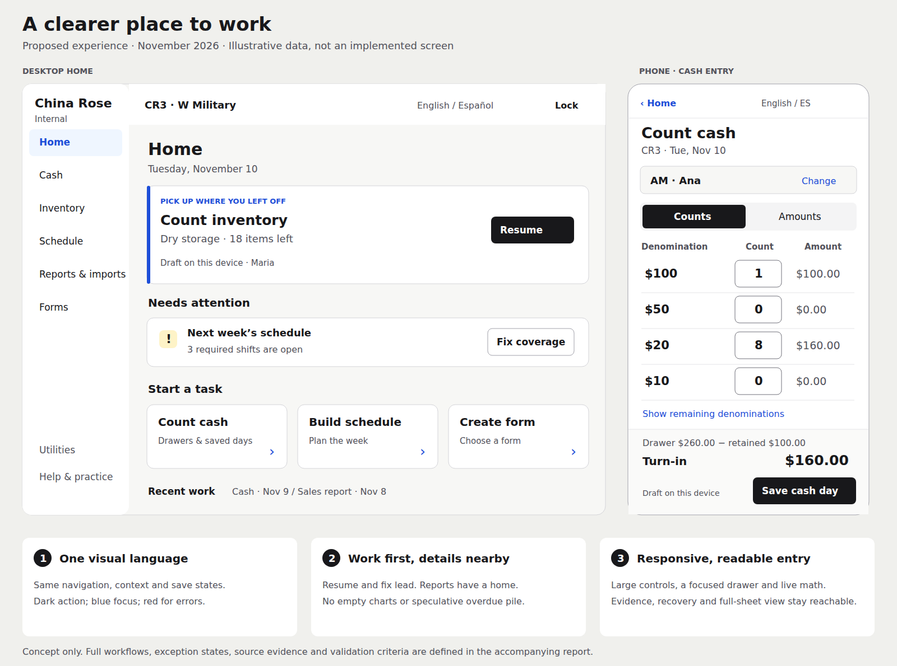

# Screens, concept and evidence

Companion to the [November 10 UX report](../internal-tools-ux-2026-11-10.md).

## Proposed appearance



The [editable vector concept](overhaul-concept.svg) illustrates hierarchy, navigation, control size, readable text and a focused task. It is a static design artifact, not an implemented app or tested responsive prototype. Its numbers and work items are examples. The full report specifies the remaining workflows and states; the image is not a complete feature specification.

## Current-main screenshots

Captured from source revision `64ffc15c013c8e1cd9ca33e8d46efc5afccb2ec3` using Next development mode, Chromium 156.0.8078.4 and synthetic loopback API responses. Desktop viewport: 1440×1000 unless stated. Screens are viewport captures, not full-page inventories. The Next development indicator is visible; it is not a production UI element.

| Screenshot | Observed state / useful evidence |
| --- | --- |
| [Home](current-home.png) | Empty cash histories. $0 total, no short days, 26 missing store-days and empty charts coexist. This is fixture behavior, not restaurant history |
| [Cash](current-cash.png) | Started device draft, initial cashier focused. Shows the many setup, draft, action, status and instruction layers before count entry |
| [Cash phone, 375×812](current-cash-phone.png) | Same draft-start scenario; focus-driven scrolling positions the first drawer in view. The warning/language header and keyboard-help summary consume substantial vertical space. No native software keyboard was opened |
| [Sales](current-sales.png) | Empty report form; file slots, preparer/context and cash fields. Lower review/recovery/history states were inspected in source, not exercised in this screenshot |
| [Hours](current-hours.png) | Empty hours form plus always-visible shared-history explanation/disabled actions; illustrates technical copy in the initial workspace |
| [Inventory](current-inventory.png) | Default item catalog with empty counts; no count history. Paper-derived borders, abbreviations and small Enough controls are visible |
| [Inventory tablet, 768×1024](current-inventory-tablet.png) | Same default count at tablet width; not a touch-device usability evaluation |
| [Forms, empty](current-forms-empty.png) | Correct empty responses; new-form choices, saved filters and blank downloads share the page |
| [Forms, rejected response](current-forms.png) | Earlier fixture used `writeups` instead of the required `writeUps` response key. The app properly reports a load failure. This is **not evidence of a production forms defect**; retained as a bounded error-state example |
| [Scheduler](current-scheduler.png) | CR3 dining-room new/default layout, one synthetic employee/template, no published week. Public-site navigation, classic switch, multiple context layers and requests panel are visible. Empty state already offers Copy last week |

Every captured step completed; requested end artifacts are marked complete within the scenario capture. No page-error events were retained. This does not establish full functional coverage: only page-error events were requested, screenshots reflect synthetic responses, and save/publish/network/error coverage beyond the listed states was not exercised. Each successful capture reports `terminated-owned-process` cleanup.

## Exact provenance

[capture-evidence.json](capture-evidence.json) contains full IDs, original local run directories, screenshot SHA-256 digests, step outcomes, completeness, events and limitations. Full raw output remains under the repository's excluded `.rea/runs/`; the index is portable but those local raw runs are not committed.

| Observation | REA evidence ID |
| --- | --- |
| Home | `ev_99eaf8bfd4abc6c2f72bb131fedef38d4ce04b92502a89b18501067661898643` |
| Cash | `ev_24500083c6c4dde3ecea5f6d5ea7382644c854ebc68adf5be4afbaf2a716318e` |
| Cash phone | `ev_a5e31630a1b8274dfe698548b9a822bd547167c0552520f9f440b8a6c265e83e` |
| Sales | `ev_4dc36727250163f4d08757cca004a5e61111738ac94d862331dea870771d338f` |
| Hours | `ev_7c90e6a0d133448e0933cd488abd4b4c891a3d1c602ea36197b0597861a24856` |
| Inventory | `ev_7c320ddea536626366f8bef3db24bd2effbb9ce788123c3ed2b6fd42d414e96e` |
| Inventory tablet | `ev_5843cdb0ba812f2b491dee246d75e8fdb043c459d6ae3d52dc2d151162e76328` |
| Forms empty | `ev_82b98252fdbc114d90a350540561ce947d8051d8a5fef2ca15eae60464bd5dea` |
| Forms malformed-response state | `ev_72dc7289864ec514cfae61ad65e78a248a7a13c5b45808af1a586cf206a67f0e` |
| Scheduler | `ev_db8d0241e38b8f5a876ccacd5cf8c6d4bdb826d6627eb45268207b6550eba18f` |

The [source manifest](source-manifest.json) hashes the selected inspected source files from the pinned worktree. Route/layout inspection and other source reads are described in the report; the manifest is a focused identity set, not an assertion that it lists every repository file.

A small REA static analysis of the emitted Home entry was also retained using:

```sh
rea-project analyze /tmp/cr-ux-main-64ffc15/.next/dev/static/chunks \
  --project /home/unusn/CR \
  --source-path 'app/(order-shell)/internal/page.js'
```

Read [bundle-summary.json](bundle-summary.json) first. Parent evidence: `ev_270227739061f34907a56ffa489d6fbe79f3db3d80de70fa45b3e8eaece35de6`; summary evidence: `ev_4dc5589e673a74f95be4a963dbd422936accaef46f24243e4c2065bc5890fbe1`. Artifact digest: `30b4b1086a2c5f0bc7ffe534ac1a200fed94c733d860ef612c92479485665733`. Local run: `.rea/runs/20261110T164030.752944Z-24a87c68/`.

That static inspection covers one selected development entry, with six inventoried files outside the selected analysis scope, 307 semantic-graph unknowns and six application-graph unknowns. Graph coverage is incomplete. It does not prove source/production parity, runtime execution of contained modules, full application coverage, or shipped artifact identity for the browser observations. Browser captures explicitly report artifact identity unavailable; source SHA and controlled server setup supply separate provenance, not a cryptographic runtime-to-source reconciliation.

Initial local rendering setup encountered a Turbopack symlink-root restriction; webpack dev mode was used. The first Chromium launch lacked shared libraries; its failed run is `.rea/runs/20261110T163758.882719Z-2b579cc0/` and supplies no UI evidence. Browser libraries were downloaded/extracted under `/tmp/cr-browser-libs`, without changing project dependencies, then successful captures were made with a scoped `LD_LIBRARY_PATH`. A mistaken `.next/static` analysis path was rejected before analysis; the correct dev output path above was then used.

## Reproduction inputs

[capture-inputs](capture-inputs) contains the exact successful scenario inputs. [fixtures.py](fixtures.py) supplies only synthetic GET/OPTIONS responses on loopback port 8799 and refuses write requests. Its corrected forms response reproduces the empty-library capture; reproducing the retained malformed-response screen requires changing `writeUps` to `writeups` for that one response. Tokens in these inputs are invented strings accepted only by the fixture, not credentials.

Use a detached checkout of the pinned revision and installed locked dependencies. The original environment reused an existing node_modules directory through a temporary symlink; this is why webpack was selected. In separate terminals, from that checkout:

```sh
# Use the actual path to this evidence directory if working in another checkout.
python3 /home/unusn/CR/docs/investigations/internal-tools-ux-assets/fixtures.py
NEXT_PUBLIC_SCHEDULE_API=http://127.0.0.1:8799 npm run dev -- \
  --webpack --hostname 127.0.0.1 --port 3037

# Select an installed compatible Chromium in the input if this path differs.
rea-project run --project /home/unusn/CR -- \
  capture-browser-scenario \
  /home/unusn/CR/docs/investigations/internal-tools-ux-assets/capture-inputs/home.json \
  --format json
```

If using the temporary extracted browser libraries from the original run, prefix the capture command with `LD_LIBRARY_PATH=/tmp/cr-browser-libs/root/usr/lib/x86_64-linux-gnu`. Other machines should use their existing compatible browser/prerequisites. The source-only report does not require this environment setup to read.

Dates in screenshots reflect the capture date/time; rerunning on another day changes the default day and missing-day list. No manager write/save or publication action is part of these scenarios. Cash creates only a local device draft in an owned temporary browser profile. The optional assistant API was not configured.

## Verification

The deliverable was checked for local Markdown targets/anchors, JSON/XML validity, PNG signatures/digests, source hashes against the pinned Git commit, capture step/completeness/cleanup status, and documentary scope. The concept was rendered and visually inspected. The remote main SHA was checked again after the audit. Application tests/builds were not rerun for this documentation-only change; the development render is not a release gate or staff acceptance result.

[verification.json](verification.json) records the final check scope and counts. Temporary development and fixture servers were stopped after capture; the detached source worktree and raw local REA runs remain available for follow-up inspection.
